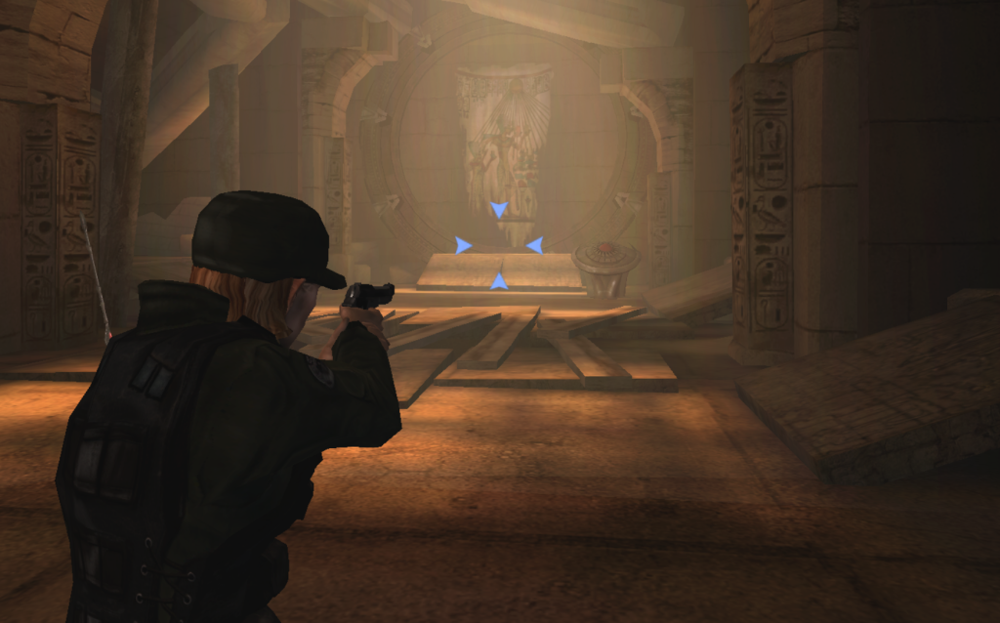

# Stargate SG-1: The Alliance - Xbox static recompilation



A work-in-progress native Windows port of the unreleased Xbox game *Stargate SG-1: The Alliance* (Unreal Engine 2, XDK 5849). This repository is a fork of [TGP482/XboxXBERecomp](https://github.com/TGP482/XboxXBERecomp): the SDK is at the top level (its own README is [README-XboxXBERecomp.md](README-XboxXBERecomp.md)) with a few changes for this game, and the game itself is in [`games/sg1`](games/sg1). The game's x86 code is recompiled to native x64 code. The Xbox's Direct3D 8 calls are carried out by a Direct3D 12 renderer, its sound by XAudio2, and its controllers by SDL3.

**No game files, no recompiled game code and no executables are in this repository.** You need your own copy of the game. The build recompiles your own `default.xbe` on your machine.

> The first version of this port was built on [sp00nznet/xboxrecomp](https://github.com/sp00nznet/xboxrecomp), with an emulated NV2A GPU translated to Direct3D 11. This version replaces it. The new engine is much faster (hundreds of fps instead of 25-35) and fixes several of the old renderer's problems, such as the M17 alarm beacons and the crash on "Exit to main menu".

## Status
Boots Unreal Engine 2, plays the animated main menu, and has sound, keyboard, mouse and gamepad. Profiles can be created, and story and multiplayer maps load and play. On top of the game itself:
- an in-game settings menu (Insert): mouse, FOV, widescreen, display mode and resolution, HD textures
- a voice command menu (V)
- widescreen and ultrawide (the 3D view is drawn for the window's shape, Hor+)
- the HD texture pack and your own textures
- the game script fixes and the co-op / multiplayer script fixes from the first port

Known gaps:
- The sand floor on some maps is blurry: the game stretches a small texture over it (it looks the same on the Xbox).
- Menus, videos and other 2D are stretched to the window's shape on a wide screen. The HUD keeps its 4:3 layout in the middle of the screen.
- The first time an effect is drawn the game can stutter briefly while the renderer prepares it.
- Co-op over the network has not been tested with the new engine yet.

## Layout
- `runtime/`, `tools/`, `xdk/`, `cmake/` ... - the XboxXBERecomp SDK. Our changes to it are in `runtime/gpu/` (widescreen fill and HD texture replacement in `d3d12.cpp`, `shaders.cpp`, `shaders.h`, `ext.h`) and `runtime/core/log.h` (full logging with `XBE_VERBOSE`).
- `games/sg1/` - the game:
  - `src/game/`:
    - `hooks.cpp` - crash workarounds and fixes to the game's code
    - `kbm.cpp` - keyboard and mouse, the menu cursor, console commands (FOV)
    - `menus.cpp` - the Insert settings menu and the V voice menu
    - `texpack.cpp` - the HD texture pack and custom textures
    - `wide.cpp` - widescreen for the gun, hands and HUD
    - `nonlocal.cpp` - `setjmp` / `longjmp` (a texture that will not decode crashed some maps)
  - `src/common/game_info.cpp` - the game's settings and its hooks into the SDK
  - `config/game.toml` - the recompiler config: the game's functions, data and instruction hooks
  - `tools/` - tools for your game files:
    - `setup_game_files.py` - the game script fixes (see Quick start)
    - `make_hdpack.py` - builds the HD texture pack
    - `multiplayer/` - the co-op and multiplayer script fixes
    - the individual script patches (the setup runs them for you)
  - `build.bat`, `release.bat`, `make_texpack.bat`, `run_verbose.bat`

## Quick start
You need:
- Windows 10/11 and a GPU with Direct3D 12
- [Visual Studio 2022](https://visualstudio.microsoft.com/) with "Desktop development with C++" (`build.bat` offers to add the Clang and CMake components it needs)
- [Git](https://git-scm.com/download/win)
- [Python 3](https://www.python.org/downloads/) (tick "Add to PATH"), for the game file fixes and the HD texture pack
- your own copy of the game, extracted from your disc image (a folder with `default.xbe`, `System\`, `Maps\`, `Textures\` ...)

1. Clone this repository:
   ```
   git clone https://github.com/SinonVT/Stargate-SG-1-The-Alliance-recomp
   cd Stargate-SG-1-The-Alliance-recomp\games\sg1
   ```
   Everything below happens in `games\sg1`.
2. Copy your whole game folder's contents into `assets\`, so that you have `assets\default.xbe`, `assets\System\` and so on.
3. Apply the game file fixes. They change only your copy in `assets\` and keep backups:
   ```
   py tools\setup_game_files.py
   ```
4. Build:
   ```
   build.bat
   ```
   The first time it recompiles the game, which takes 30 to 90 minutes. Later builds only compile what changed.
5. Play: `out\build\release\SG1.exe` (`build.bat` offers to start it). The first start finishes building the game code, `SG1.dll`, which takes a few minutes once.
6. Optional: the HD texture pack, see below.

`release.bat` makes a zip that others can play from. It holds no game code: the player puts their own game in its `assets` folder and the first start builds the game code from it.

**New Game.** The game asks for a map called `Tutorial ` (Yes) or `M01A` (No) that the dump does not contain, and it freezes if they are missing. `M00.unr` is the tutorial level, so the setup creates `Maps\Tutorial .unr` (the real tutorial) and `Maps\M01A.unr` (a copy of `M02A.unr`: the real first mission is missing, so No starts mission 2 instead). It also writes two silent placeholder tracks, `Music\multiplayer\multiplayer_music1.WAV` and `...2.WAV`, which the dump does not contain. Without them deathmatch asks for the tracks every ~100 ms and stutters. Existing files are never overwritten.

**Keyboard layout.** The dump's `System\User.ini` has the PC prototype layout (B unbound, Ctrl = jump ...). The setup runs `tools\controls_preset.py`, which sets this port's layout (below) and the voice command keys (backups `*.orig_sg1`, `--revert` restores them).

**What else the setup fixes in the game's scripts.** Each fix has its own tool in `tools\`, keeps a backup and has a `--revert`:
- the stargate in the main menu that never closes
- non-team chat, the Last Man Standing menu entry and the missing `Replicator.ini`
- the health bar in story mode
- the player name from the selected profile
- higher graphics settings (textures High, weather and high detail actors on)
- the co-op / multiplayer fixes (`--no-multiplayer` skips them, see `tools\multiplayer\README.md`)

**Optional: grass.** The Xbox build cut the terrain grass from the first level, but the engine support and the grass model are still there. To add it, close the game and run `py tools\install_grass.py assets` (or `install_grass.bat`). It only edits `Maps\M01A.unr` (backup `M01A.unr.nograss`); options are `--scale 0.3 --dens 0.25`, and `--undo` restores the plain map.

## HD texture pack
The game only uploads reduced copies of its textures, but the original art (up to 1024 or 2048 px) is still in `Textures\*.utx`. The pack is built from your own game files, so it is not in the repository (about 850 MB).

Run `make_texpack.bat`, or press "Extract HD textures" in the Insert menu. It needs Python 3 and installs numpy and Pillow if they are missing. It writes `out\build\release\texpack\hd\*.png` and `texpack\index.txt` in a few minutes; if it is stopped, running it again resumes. Press "Reload textures" in the Insert menu when it says DONE. The default size cap is 1024 px per texture; pass another as an argument (`make_texpack.bat 512`) if a level runs out of video memory.

Textures load in the background, so one can sharpen a moment after it first appears.

**Your own textures.** Put a PNG in `texpack\custom` with the same file name as one in `texpack\hd`. You can also name it after the texture's ID, `f<format>_<width>x<height>_<hash>.png`, which also works for textures the pack does not cover. Files in `custom` win over the pack while "Custom textures" is on in the Insert menu (it is on by default). Delete a file to go back. `texpack\upscale_dump.bat` runs Real-ESRGAN over the whole `hd` folder into `custom`, if you have it.

## Widescreen / ultrawide
With "Fill the window" on (the default), the 3D view is drawn for the window's shape at any aspect: 16:9, 21:9, 32:9. The game has no widescreen support of its own, so the port widens the field of view (Hor+: the vertical view stays what 4:3 gave). It also widens the gun, the hands and the HUD to match. The FOV is typed into the game's console about 3 seconds after you are in a level with no menu up, and again when the window changes shape; the game saves it in `System\User.ini`. Menus, videos and 2D are stretched to the window. Turn "Fill the window" off for the original 4:3 picture.

## In-game settings (Insert)
Insert (or Esc) opens and closes the settings menu. The game gets no keyboard or mouse while it is open. Settings are saved to `out\build\release\settings.toml`.
- **Mouse:** look sensitivity (default 50, PgUp/PgDn change it in game), menu cursor speed, invert Y.
- **Widescreen / field of view:** fill the window, FOV at 4:3 (default 75), Hor+, "Apply now".
- **Textures:** HD texture pack, custom textures, Extract HD textures, Reload textures.
- **Display:**
  - display mode (Windowed, Borderless or Fullscreen; the first start is Windowed)
  - resolution
  - render scale (100 = native, up to 400 for supersampling)
  - FPS cap and VSync
  - anisotropic filtering

  A maximized window stays maximized, also across "Exit to main menu", which restarts the game.

## Voice commands (V)
In a match, V opens the voice menu: the mouse wheel picks a line and left click says it (the click does not fire). V again or Esc closes it. Each line presses a key whose `User.ini` binding is `Taunt <MSGID>` (NumPad0-9 and F13-F18, set by `controls_preset.py`); you can bind those keys yourself too. The lines are only the ones all four SG-1 voice packs have: taunt, OK, negative, ready, enemy spotted, take cover, enemy killed, area clear, under fire, team under fire, man down, in cover, holding fire, firing, friendly fire.

## Controls
In a match the keyboard and mouse go to the game through its own bindings in `System\User.ini`. The layout from `tools\controls_preset.py` (backups `*.orig_sg1`):

| Action | Keys |
|---|---|
| Move | W/A/S/D |
| Jump | Space |
| Duck | Ctrl or C |
| Walk | Shift |
| Reload | R |
| Use | F or Enter |
| Weapons | number keys (5 = binoculars), mouse wheel cycles |
| Fire / alt-fire | left / right mouse |
| Zoom | middle mouse or Z |
| Third person | B |
| Cloak | CapsLock |
| Mission information | Tab |
| Chat / team chat | T / Y |

Team commands: **Q = Concentrate Fire** (hold it, look at a squad mate or an enemy, release) and **E = Take Cover**. They need a squad, so they do nothing in deathmatch.

In menus the mouse drives the game's own cursor: left click selects, right click goes back.

Port keys:

| Key | What it does |
|---|---|
| Insert | Opens and closes the settings menu |
| V | Opens and closes the voice menu |
| ` (backtick) | Opens the game console |
| F9 | Frees or captures the mouse |
| PgUp / PgDn | Mouse sensitivity |
| F10 / F11 / F12 | The game's own Gamma + / Brightness + / Contrast + |

## Reporting a crash
Start the game with `run_verbose.bat` and do the same thing again. Then open an issue and attach the newest `game_*.log` from `out\build\release\logs`, plus the dump from `out\build\release\CrashDumps` if there is one. Say which map you were on and what you were doing.

## Credits
- Built on [TGP482/XboxXBERecomp](https://github.com/TGP482/XboxXBERecomp) (MIT, see `LICENSE`): the recompiler, the runtime and the Direct3D 12 renderer. Its third-party libraries are listed in `THIRD_PARTY.txt`.
- The first port, built on [sp00nznet/xboxrecomp](https://github.com/sp00nznet/xboxrecomp), is where many of the fixes carried over here were found.
- This is not an official project and has no affiliation with the game's rights holders.

---
<sub>*AI was used to assist with my project, but I put a lot of effort into guiding and using it for advice with crashes and other issues to help complete this project. Thank you.*</sub>
